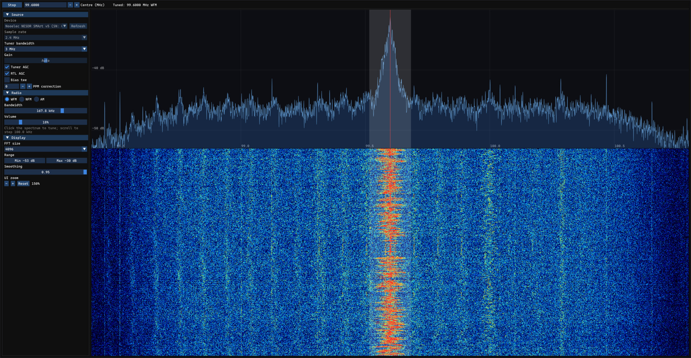

# sdr-app

A desktop receiver for RTL-SDR dongles, built for the Nooelec NESDR SMART v5 and modelled on
[SDR++](https://github.com/AlexandreRouma/SDRPlusPlus). The GUI uses Dear ImGui, and all signal
processing uses Intel oneAPI IPP.



## Features

- Detects RTL-SDR devices automatically, including ones plugged in while the app is running
- Play/Stop for streaming and audio output
- Source controls: sample rate (0.25–3.2 MHz), tuner bandwidth, manual gain or tuner AGC, RTL AGC,
  PPM correction and bias tee
- Live spectrum and waterfall, with adjustable FFT size, dB range and smoothing
- Click or drag on the spectrum to tune; scroll to step between channels
- WFM, NFM and AM demodulation, with adjustable channel bandwidth and volume
- Squelch with a signal-level meter: mutes the audio while the channel is weaker than a set level
- UI zoom with Ctrl + / Ctrl − / Ctrl 0, or Ctrl + mouse wheel

## Requirements

Linux (developed on Ubuntu) with:

| Dependency | Install |
|---|---|
| CMake 3.24+ and a C++20 compiler | `sudo apt install cmake g++` |
| librtlsdr | `sudo apt install librtlsdr-dev` |
| GLFW 3.3+ | `sudo apt install libglfw3-dev` |
| Intel oneAPI IPP | [oneAPI Base Toolkit](https://www.intel.com/content/www/us/en/developer/tools/oneapi/base-toolkit.html), expected at `/opt/intel/oneapi` |

The build also downloads [Dear ImGui](https://github.com/ocornut/imgui) and
[miniaudio](https://github.com/mackron/miniaudio) automatically, so it needs internet access the
first time.

IPP is linked statically, so you don't need to run oneAPI's `setvars.sh` to build or run the app.

## Build and run

```sh
cmake -B build
cmake --build build -j
./build/sdr-app
```

## Using it

1. Plug in the dongle. It appears under **Source → Device**.
2. Choose a sample rate (2.4 MHz is the highest that's reliable), then press **Play**.
3. Type a centre frequency in MHz at the top, for example `99.6`.
4. Pick a mode under **Radio** (WFM for broadcast FM), then click a signal on the spectrum to tune
   to it. The red line and shaded band show what you're listening to.
5. Adjust **Gain** until signals stand clear of the noise without the noise floor rising too high.
6. For NFM or AM, tick **Squelch** and drag its level just above the meter's reading with no signal.
   The hiss is then muted until a transmission comes through.

The device and sample rate are locked while playing. Every other setting can change live.

## Troubleshooting

**"Could not open the device"**: the kernel's DVB-T TV driver has probably claimed the dongle.
Unload it, and blacklist it so it stays unloaded after a reboot:

```sh
sudo rmmod dvb_usb_rtl28xxu
echo 'blacklist dvb_usb_rtl28xxu' | sudo tee /etc/modprobe.d/blacklist-rtl.conf
```

**Device not listed, or a permission error**: install the rtl-sdr udev rules
(`sudo apt install rtl-sdr`), then unplug and replug the dongle.

**Regular spikes across the spectrum**: this is interference, often from nearby USB devices such
as USB Ethernet adapters. Moving the dongle onto a USB extension cable usually helps.

## Project layout

| File | Purpose |
|---|---|
| `src/main.cpp` | Window, OpenGL and ImGui setup, font loading and UI scaling |
| `src/App.*` | The user interface, and starting and stopping the radio |
| `src/RtlSdrSource.*` | Device discovery, settings and async streaming via librtlsdr |
| `src/Receiver.*` | Passes samples from the SDR thread to the DSP and outputs |
| `src/Dsp.*` | IPP signal processing: FFT, resamplers and filters, NCO, demodulators |
| `src/AudioSink.*` | Audio output via miniaudio |
| `src/Waterfall.*` | Waterfall display, stored in an OpenGL texture used as a ring buffer |
| `src/Gl.h` | The few OpenGL functions the app calls directly |

## Licence

GPL-3.0, see [LICENSE](LICENSE).

The bundled [Cascadia Mono](https://github.com/microsoft/cascadia-code) font is © Microsoft and
licensed under the SIL Open Font License 1.1.
